# BeamCX

A 2D Euler–Bernoulli calculator for the original TI-Nspire CX CAS: a teaching and engineering-check tool, not a design-code verifier.

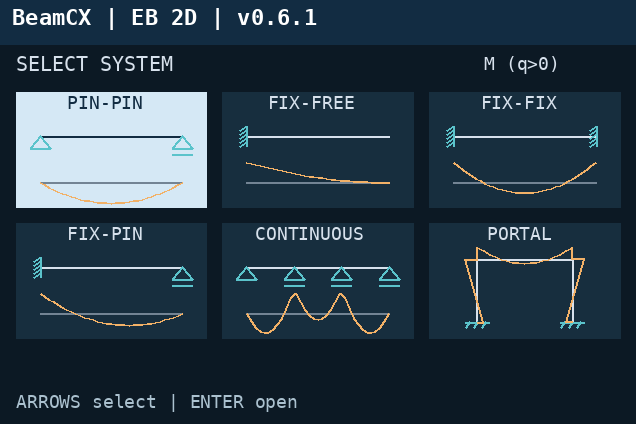

*PC rendering of the app's actual drawing commands; fonts approximate the calculator.*

## Features

- Six systems: PIN-PIN, FIX-FREE, FIX-FIX, FIX-PIN, CONTINUOUS and PORTAL.
- Single-span uniform and point loads, reactions, M/V/w diagrams and a movable cursor.
- Continuous beams with 2–5 spans, PIN/FIX ends and moment, shear and reaction envelopes.
- Rectangular portals with PIN/FIX bases, N/V/M, absolute deformed shape and chord-relative beam deflection.
- Offline MANUAL, concrete RECT and steel IPE/HEA sections; independent Columns / Beam groups for portals.
- Optional self-weight for beams; portal columns are excluded.
- Explicit CAS export and full-precision TI document save/restore.
- One standalone TI-Lua application; no Ndless, Python, network or extra calculator libraries.

## Install

1. Download **BeamCX.tns** from the [release page](https://github.com/sflabbe/BeamCX/releases).
2. Transfer it with [N-Link Web](https://n-link.lights0123.com/) in Chrome/Chromium.
3. Use a simple filename, **BeamCX.tns**, and the calculator's root folder.
4. Open it from **My Documents**. Do **not** use N-Link's **Upload OS** for a document.

The hardware used for recorded tests is the original TI-Nspire CX CAS with OS **4.5.5.79**. Release-specific device evidence is described under [Validation](#validation).

## Use

Choose a system with the arrows and press ENTER. TAB cycles **Input → Results → Sections → Input**. Continuous and portal results calculate when entered after an edit; leaving results cancels pending work.

| Key | Selector | Input / sections | Diagrams / results |
| --- | --- | --- | --- |
| ↑ / ↓ | Choose row | Choose editable field | Move cursor; select/scroll table rows |
| ← / → | Choose column | Change support, span count, group, material, profile or setting | Change result mode |
| ENTER | Open system | Apply a number or selection | Open table; ENTER again exports CAS |
| TAB | No effect | Advance page | Open sections |
| ESC | No effect | Cancel typing; otherwise selector | Return to selector |
| Backspace | No effect | Delete last typed character | No numerical action |
| 1 / 2 / 3 | — | — | Portal: left column / beam / right column |

### Single-span beams

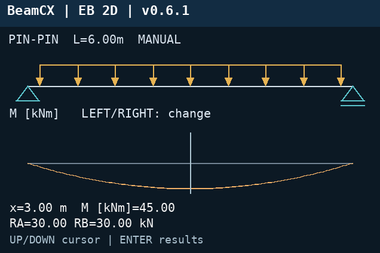
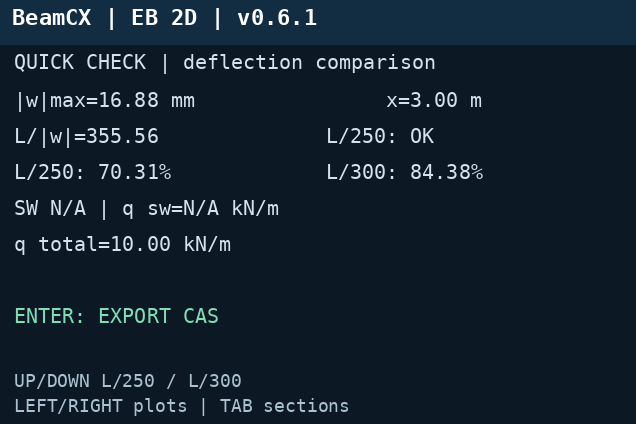

*PC rendering of the app's actual drawing commands; fonts approximate the calculator.*

Enter L and point-load position a in **m**, q in **kN/m**, P in **kN**, and manual EI in **kNm²**. Positive q/P act downward; negative values reverse them. Sagging **M+ is drawn below the beam**. Reactions and single-span w are upward-positive; the compact comparison reports absolute maximum deflection in **mm**.

Use ← / → for M, V, w and the compact comparison. Select **L/250** or **L/300** in that comparison with ↑ / ↓. These are comparison limits, not compliance checks. For concrete cantilevers, the reference length is **2.5L**; steel and MANUAL cantilevers use L and display **AGREE LIMIT**.

### Continuous beams

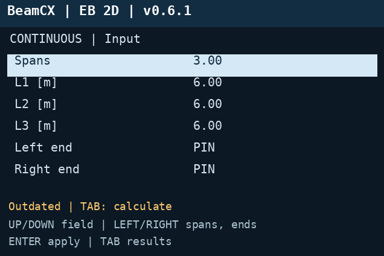
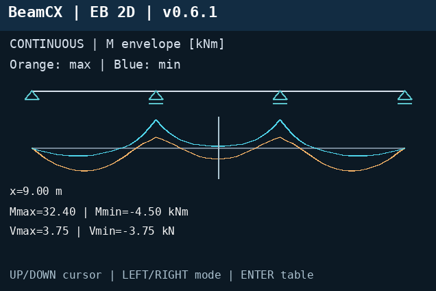
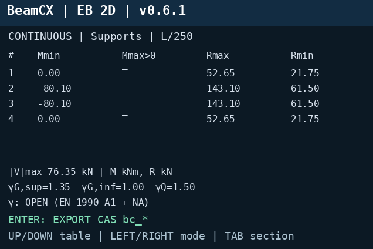

*PC rendering of the app's actual drawing commands; fonts approximate the calculator.*

Choose 2–5 spans and their lengths in **m**, PIN/FIX ends, permanent g and variable q in **kN/m**, the shared EI in **kNm²**, and the dimensionless load factors. Positive loads act downward. M+ is drawn below the axis; the characteristic w plot uses downward-positive mm. The table switches between span results and support reactions with ↑ / ↓.

Moment, shear and reaction envelopes use favorable/unfavorable load contributions and both global permanent-load factors. Characteristic deflection uses the odd/even variable-load patterns with unit factors: verified against exhaustive cases, not a theorem for every configuration. The displayed factor convention is **OPEN (EN 1990 A1 + NA)**; project and National Annex checks remain necessary.

### Rectangular portals

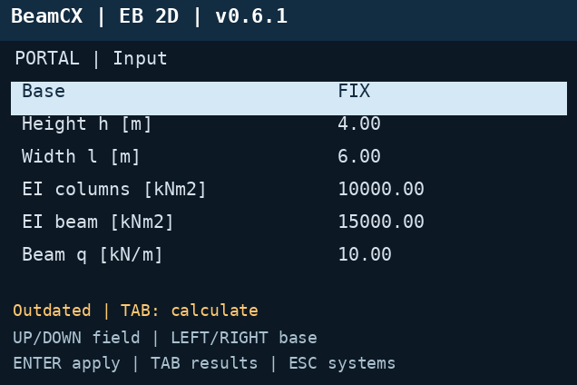
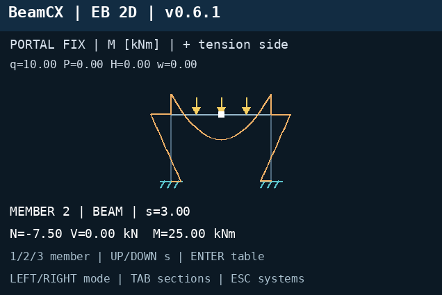
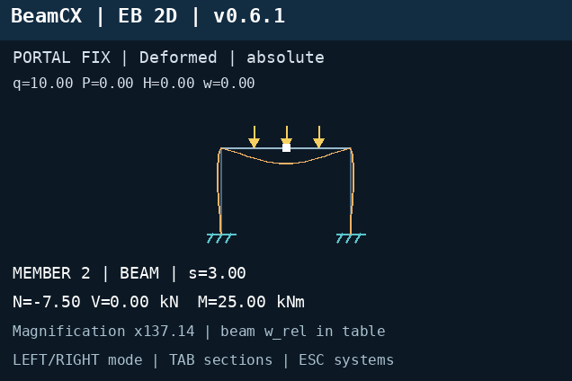

*PC rendering of the app's actual drawing commands; fonts approximate the calculator.*

Enter height h, width l and point-load position a in **m**, column/beam EI in **kNm²**, beam q and left-column wind w in **kN/m**, and point P / left-eave H in **kN**. Both bases are PIN or both FIX. Positive q/P act downward; positive H/w act rightward.

M is drawn on the **tension side**: M+ is rightward for both columns and downward for the beam. N is positive in tension; V retains the local-member convention. Both columns run from base to eave. Keys 1/2/3 select left column, beam and right column; ↑ / ↓ moves along local s and visits both shear limits at a point load.

Use ← / → for M, V, N, Deformed and Results. The deformed drawing shows absolute recovered displacement with a stated magnification. The table's beam deflection is separately measured relative to the displaced end chord. For the default portal, the checked approximate values are **M corner −20 kNm, M center 25 kNm and beam N −7.5 kN**.

### Sections, self-weight and display

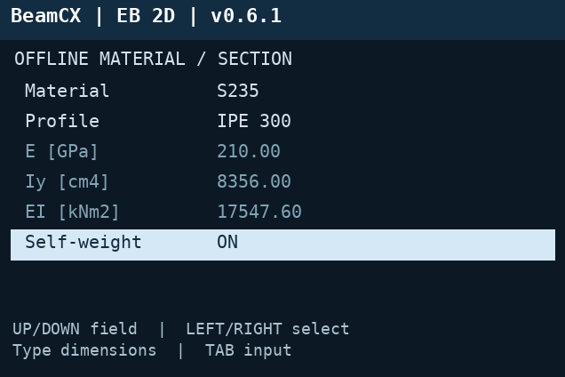
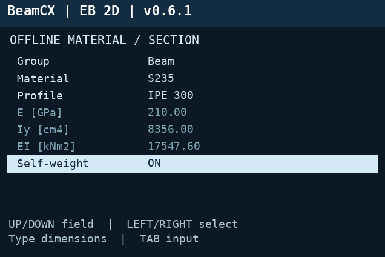
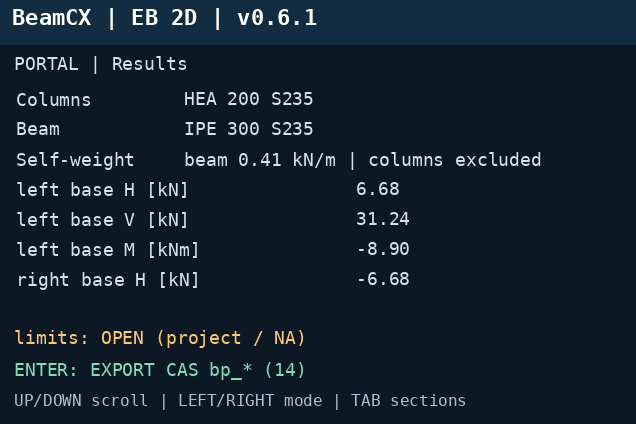

*PC rendering of the app's actual drawing commands; fonts approximate the calculator.*

Choose MANUAL EI, concrete RECT dimensions b/h in **mm**, or a steel profile. Catalogue EI is automatic; edit it through the section instead of the input EI field. Portals have independent **Columns** and **Beam** groups; Columns applies to both columns.

Self-weight starts OFF. When ON, steel mass or concrete dimensions supply it once: added to single-span q, continuous g, or portal beam q. The typed load is retained. MANUAL has no weight data and switches it OFF. Portal columns display **Excluded (axial)**. The portal load header adds **sw=…** only when active; its table records section and load provenance.

Numbers show two decimal places. Nonzero magnitudes below **0.005** or at least **10⁷** use scientific notation; negative zero displays as **0.00**. Typed values, saved documents and CAS exports keep full precision.

## Export to CAS

Press ENTER in the result table to store values in the **same TI-Nspire problem**. Export is explicit; it does not run automatically. An error can leave earlier variables stored, so confirm the success message before using the set.

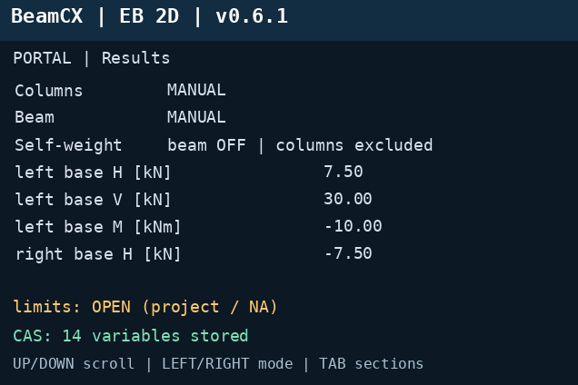

*PC rendering of the app's actual drawing commands; fonts approximate the calculator.* The CAS API in this image is a test double: the application performs its real export, but this is not evidence of stores on a physical calculator.

The 30 names below follow the application's export code. H is right-positive, V reactions upward-positive and base moments counterclockwise-positive. Display rounding is not applied to exports.

| Variable | Unit | Meaning |
| --- | --- | --- |
| `bx_mmax` | kNm | Single-span algebraic M maximum |
| `bx_mmin` | kNm | Single-span algebraic M minimum |
| `bx_vabs` | kN | Maximum absolute shear |
| `bx_wmax` | mm | Maximum absolute deflection |
| `bx_xwmax` | m | Its position from the left end |
| `bx_ra` | kN | Left vertical reaction |
| `bx_rb` | kN | Right vertical reaction; zero at a free end |
| `bx_ei` | kNm² | Single-span flexural rigidity |
| `bc_mmax` | kNm | Global continuous-beam algebraic M maximum |
| `bc_mmin` | kNm | Global continuous-beam M minimum |
| `bc_vabs` | kN | Global maximum absolute shear |
| `bc_rmax` | kN | Maximum support reaction |
| `bc_wmax` | mm | Governing absolute characteristic deflection |
| `bc_xwmax` | m | Its global position |
| `bc_ei` | kNm² | Shared flexural rigidity |
| `bc_n` | — | Span count |
| `bp_hl` | kN | Left-base horizontal reaction |
| `bp_vl` | kN | Left-base vertical reaction |
| `bp_ml` | kNm | Left-base reaction moment |
| `bp_hr` | kN | Right-base horizontal reaction |
| `bp_vr` | kN | Right-base vertical reaction |
| `bp_mr` | kNm | Right-base reaction moment |
| `bp_mmax` | kNm | Global member algebraic M maximum |
| `bp_mmin` | kNm | Global member algebraic M minimum |
| `bp_nabs` | kN | Maximum absolute member axial force |
| `bp_vabs` | kN | Maximum absolute V, including point-load sides |
| `bp_dxl` | mm | Signed left-eave horizontal drift |
| `bp_dxr` | mm | Signed right-eave horizontal drift |
| `bp_wrel` | mm | Signed governing chord-relative beam deflection |
| `bp_xwrel` | m | Its local position along the beam |

Portal PIN-base moments export numeric zero. Active self-weight is included in the corresponding results.

## Saved documents

Only complete **0.6.1** documents are accepted. Any other format or malformed document resets all input to defaults with **Invalid document or version: defaults restored**. There is no migration.

Section groups, self-weight, active system/page/mode and cursor are saved. Continuous/portal results reopen at input and calculate on normal results entry. Numerical solutions and timers are not saved. Portal EI is recomputed from the saved sections before validating the model.

## Scope and limitations

- Linear, first-order, small-displacement, prismatic Euler–Bernoulli analysis; no second-order stability, dynamics or resistance checks.
- Concrete uses gross, uncracked EI; no cracking, creep or long-term deflection.
- Portal axial stiffness is the approximation **EA = 1e6·EI/L²**, not physical E·A; column self-weight is excluded.
- The general engine is limited to **20 nodes**; the app offers only the listed systems and load types.
- Continuous-beam envelope factors remain **OPEN** for project / National Annex verification.
- Deflection limits and displayed status are comparisons, not normative certification. Independently verify engineering use.

## Validation

Desktop regression comprises **16 suites** in Lua **5.1.5** and **5.4.7**, retaining **394** Frame oracle rows, **2,042** historical beam cases, **300** independent continuous models and **136** portal models. Earlier calculator tests used the hardware identified above; physical acceptance of this release has not yet been recorded. See [technical evidence and reproduction commands](docs/VALIDATION.md).

## Build from source

```bash
python3 build.py
luac5.1 -p BeamCX.lua
python3 tools/package.py
```

See [development instructions](docs/DEVELOPMENT.md) for dependencies, tests, packaging, benchmarks and image regeneration.

## Data references

- Concrete Ecm: [Betontechnische Daten](https://www.betontechnische-daten.de/de/betontechnologie/formaenderungen/elastische-verformung).
- Steel modulus: **210 GPa** for S235 and S355, following the EN 1993 elastic convention; stored properties are in [section_db.lua](src/section_db.lua).
- Nominal strong-axis properties: [crosssections.app IPE](https://crosssections.app/en/guides/ipe-complete-guide) and [HEA](https://crosssections.app/en/hea).
- Steel mass: **ArcelorMittal, Sections and Merchant Bars, 2021 Sales Programme**, IPE / HE A tables, column G [kg/m] ([manufacturer PDF](https://sections.arcelormittal.com/repository2/Sections/Sections_MB_ArcelorMittal_FR_EN_RU.pdf), PDF pages 48/50 and 56/58). HE A corresponds to the catalogue's HEA names.
- Concrete self-weight uses the documented nominal assumption **25 kN/m³**, including a conventional reinforcement allowance; it is not inferred from grade or reinforcement quantity.
- Concrete cantilever reference length: [DIN EN 1992-1-1/NA, NCI to 7.4.1(4), PDF page 144](https://www.niedersachsen.de/download/140002/Nds._MBl._Nr._3_2019_vom_24.01.2019_Anlagenband_1-Teil_1.pdf#page=144). Steel/MANUAL limits require project agreement; EN 1993-1-1, 7.2 supplies no universal equivalent cantilever span.

## License

MIT — see [LICENSE](LICENSE). The beam formulation was adapted for a restricted TI-Lua application using Euler–Bernoulli frame-element stiffness terms; this is not a complete port of `dinamica-computacional`.
